# DocuMine: informal in, formal out

## Problem
Problem Statement 40: engineering knowledge is scattered across chats, rough notes, source code and
incident records. Turning it into proper documentation takes time, and generic AI chat tools need
careful prompts, do not show where facts came from, and invent details.

DocuMine turns informal, mixed input into structured technical documents in one click. There is no
prompt to write, every statement cites its sources, and a person reviews each draft before approving it.

## Status: read this first
- **84 automated tests pass** (`python -m pytest`). They run **offline**: the database and Gemini are
  replaced with fakes.
- **Not yet verified against the real services.** The end-to-end smoke test (`tests/smoke_test.py`) and
  the retrieval evaluation (`tests/evaluate.py`) have only been run without a `.env`, where they stop at
  "Missing setting". **No accuracy numbers have been measured yet**, so none are claimed here.
- `sql/schema.sql` has not yet been run on a real Supabase project.

## Features (implemented and covered by offline tests)
- **Upload** TXT, MD, PDF (page numbers kept), DOCX (tables included), Python (split by function and
  class with `ast`), JavaScript, Java and ZIP archives.
- **Input checks**
  - 25 MB limit per file; duplicate uploads detected by sha256.
  - ZIPs are read in memory only, never extracted to disk. Limits on entry count, file count and total
    uncompressed size. Paths that escape the folder are refused.
  - `.git`, `node_modules`, virtual environments, `.env`, key files and binaries are skipped.
  - Files that look like they contain a password or API key are skipped and never uploaded.
  - Scanned PDFs without text are reported instead of failing.
- **Chunking**: about 1200 characters with 150 overlap, preferring paragraph and function boundaries.
  Every chunk records a location such as `page 3` or `lines 10-42`.
- **Hybrid search**: PostgreSQL full-text search (any word matches) plus pgvector cosine search on
  `gemini-embedding-001` embeddings (768 dimensions), merged with reciprocal rank fusion. If one method
  fails, the other is used alone, so keyword search keeps working without embeddings.
- **One-click generation** of Meeting Minutes, Technical Design Document, Code Documentation and Project Report:
  - fixed templates and prompts, numbered sources, structured JSON output;
  - large selections are summarised in batches and then combined, keeping the source numbers;
  - checks for required sections and real citation numbers, with one retry;
  - anything still wrong is repaired and flagged for the reviewer.
- **Ask**: answers only from retrieved chunks, with `[1]`-style citations. Citations to sources that do
  not exist are removed. If nothing is found, it says "I could not find this in the project files."
  without calling the model.
- **Review**: possible issues for human review (conflicting statements, possibly outdated content,
  missing documentation), each linked to its sources.
- **Human review**: edit, save as draft, approve, and download as `.md` or `.docx`.
- **Prompt-injection guard**: source text is wrapped and escaped as data, and the model is told to ignore
  instructions inside it.

## Pipeline

```mermaid
flowchart LR
    A["Input<br/>chat, notes, PDF, DOCX,<br/>code, ZIP"] --> B["Checks<br/>25 MB limit, ZIP safety,<br/>secret scan, sha256 duplicates"]
    B --> C["Extract<br/>pypdf, python-docx,<br/>ast for Python"]
    C --> D["Chunk<br/>~1200 chars, 150 overlap,<br/>page / line locations"]
    D --> E["Store<br/>Supabase Storage (original)<br/>PostgreSQL chunks + tsvector<br/>pgvector embeddings"]
    E --> F["Retrieve<br/>keyword + vector,<br/>reciprocal rank fusion"]
    F --> G["Prompt<br/>fixed template,<br/>numbered sources as data"]
    G --> H["Gemini<br/>gemini-3.5-flash-lite,<br/>structured output"]
    H --> I["Validated output<br/>required sections, real citations,<br/>one retry, flagged repairs"]
    I --> J["Human review<br/>edit, save, approve,<br/>download .md / .docx"]
```



Generate reads all chunks of the selected files directly, while Ask uses the retrieve step.

## Setup
1. Python 3.11 or newer (tested on 3.14).
2. `python -m venv .venv`, then activate it (Windows: `.venv\Scripts\activate`).
3. `pip install -r requirements.txt`
4. Copy `.env.example` to `.env` and fill in `GEMINI_API_KEY`, `SUPABASE_URL` and `SUPABASE_KEY`
   (the **secret** key, not the publishable one). `GEMINI_MODEL` defaults to `gemini-3.5-flash-lite`.
5. In Supabase, open **SQL Editor**, paste all of `sql/schema.sql` and click **Run**. It is safe to
   run again. It creates the tables, the private `uploads` bucket, row level security, keyword search
   and the pgvector parts.
6. Start the app: `streamlit run app.py`

## Testing
| Command | What it does | Needs .env |
|---|---|---|
| `python -m pytest` | 84 unit tests with fake database and model | no |
| `python tests/smoke_test.py` | full flow on sample_data against the real services, PASS/FAIL per stage | yes |
| `python tests/evaluate.py` | top-5 file hit rate on 20 questions for keyword, vector and hybrid search | yes |
| `python scripts/backfill_embeddings.py` | embeds chunks that have no embedding yet, in batches | yes |

## Sample data
`sample_data/` holds a fictional project, "Kestrel" (greenhouse sensor monitoring), labelled as sample data:
- a team chat;
- rough design notes;
- an incident record (`.docx`);
- a small Python service (`.zip`).

It contains clear decisions and action items, plus one deliberate contradiction: the chat says raw
readings are kept for 90 days and the design notes say 30. `python sample_data/make_samples.py`
rebuilds the `.docx` and `.zip`.

## Project layout
```
app.py                Streamlit UI (Upload, Generate, Ask, Review)
ui/export.py          Markdown to .docx
documine/config.py    settings from .env
documine/db.py        Supabase tables and storage
documine/llm.py       Gemini text and structured JSON, with retries
documine/ingest.py    checks, extraction, chunking, storing
documine/embeddings.py  Gemini embeddings and backfill
documine/retrieve.py  hybrid search and source formatting
documine/generate.py  one-click documents with validation
documine/templates.py fixed sections per document type
documine/answer.py    question answering with citations
documine/suggest.py   possible issues for human review
sql/schema.sql        database schema
```
Fixed interfaces between modules: `docs/PROJECT_CONTEXT.md`. Progress: `docs/PROGRESS.md`.
Demo: `docs/DEMO_SCRIPT.md`.

## Technical problems solved
Only problems we actually ran into while building, each with its cause and fix.

| Problem | Cause | Fix |
|---|---|---|
| The chat log's first chunk held only 156 characters | Oversized paragraphs were pre-split into ~1200-character pieces before packing, so a small paragraph could not share a chunk with the next piece | Oversized units are now split into single lines and `pack_units` fills each chunk greedily; the overlap can span several lines |
| The full test run crashed with `ModuleNotFoundError: kestrel` | pytest also collected the sample project's own tests inside `sample_data/kestrel_service/` | `sample_data/conftest.py` sets `collect_ignore = ["kestrel_service"]` |
| Interface tests failed once the stubs were replaced by real modules | `tests/test_interfaces.py` called the real functions, which now need Supabase and Gemini | An autouse fixture replaces the database, Gemini and embedding calls with small fakes |
| Streamlit printed deprecation warnings for `use_container_width` | Streamlit 1.67 replaced it with `width` | Switched to `width="stretch"` |
| Without a `.env`, the "Missing setting" error showed several times | The stored-file list was loaded separately by each tab | It is loaded once per run and shared by all tabs |
